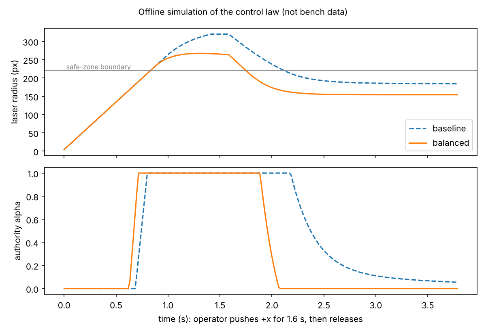

# Shared Control for a 4-DOF Desktop Arm (ROS 2 Humble)

An operator steers a small 4-DOF arm with a joystick while a virtual laser point must stay inside a circular boundary on a simulated retinal target. The arm holds the joystick, so the controller's safety correction is applied through the same joystick the operator is moving. Inside the boundary, operator input and correction are blended; outside it, the controller takes full authority and returns the point to the safe region.

**Scope.** This is my undergraduate thesis platform (SCUT / NUSRI, 2025–2026, supervised by Profs. Yong Zhong and Chui Chee Kong). It was evaluated on a physical desktop arm with a virtual (Pygame) target. It is a bench platform for studying shared control and is not a medical device and has not been tested in any clinical setting.

Demo: [[video link]] · Thesis/paper: [[link or "available on request"]]

## System Overview

```text
Joystick -> ADS1115 (A2/A3) -> hardware_adc_node -> /joy_position
                                                          |
                                                          v
                                   pygame_haptic_sim_node -> /virtual_fixture_force
                                                          -> /laser_position
                                                          -> /shared_control_feedback

FSR x2   -> ADS1115 (A0/A1) -> hardware_adc_node -> /gripper_contact
                                                 -> /gripper_overpressure
                                                 -> /gripper_sensor_fault

/joy_position + /virtual_fixture_force + FSR states -> arm_control_node -> arm_driver_node -> UART servos
```

| Node | Package | Role |
|---|---|---|
| `hardware_adc` | `sensor_interface` | Reads the ADS1115 over I2C; filters each channel (single-sample jumps are held until consecutive samples agree, then EMA); publishes joystick position and FSR contact (with hysteresis), overpressure and sensor-fault states |
| `pygame_haptic_sim` | `arm_driver` | Integrates the virtual laser point, computes the virtual-fixture force and renders the target |
| `arm_control` | `arm_driver` | State machine (INIT → HOME → TRANSIT → HOVER → GRASP/PINCH → SHARED_CONTROL, plus RETURN_* and SAFE_HOLD) and the shared-control law |
| `arm_driver` | `arm_driver` | Inverse kinematics and the serial bus-servo driver |

### Shared-control law

Implemented in `arm_driver/arm_driver/shared_control_math.py` (`compute_target_offset`):

- **Inside the boundary:** an authority factor `alpha` in [0, 1] rises with the virtual-fixture force magnitude. The commanded offset is `(1 - alpha) * operator_offset + alpha * safety_correction`, clipped to the workspace.
- **Outside the boundary:** `alpha = 1`; the controller pushes the point back toward the centre, with a push ratio that increases with the distance outside the boundary.

Default shared-control plane: centre `(0.22, 0.00, 0.08) m`, workspace `x = 0.22 ± 0.016 m`, `y = 0.00 ± 0.016 m`, fixed `z = 0.08 m`.

## My Contribution and Third-Party Components

| Part | Author |
|---|---|
| ROS 2 packages, node design, shared-control law, state machine, sensor processing, launch files, parameter sets, experiment tools | Me (Peiqi Huang) [[confirm; note any supervisor- or lab-provided code]] |
| `arm_driver/arm_driver/fashion_star_sdk.py` | Fashion Star bus-servo Python SDK by the servo vendor (Shenzhen Huaxinjing Technology), used unmodified [[confirm]] |
| Hardware: 4-DOF arm, ADS1115 ADC, FSR sensors, joystick | Commercial parts [[arm model]] |

## Requirements 

- Ubuntu 22.04, ROS 2 Humble, Python 3
- ADS1115 I2C ADC, UART bus-servo arm
- Pygame, NumPy, pandas, matplotlib, seaborn, smbus2

```bash
sudo apt update
sudo apt install -y \
  python3-numpy python3-pygame python3-smbus2 python3-serial \
  python3-matplotlib python3-pandas python3-seaborn \
  ros-humble-rosbag2-py ros-humble-rosidl-runtime-py
```

## Build and Run 

```bash
mkdir -p ~/arm_project_ws/src
git clone https://github.com/PatrickHuang-p7/eye-surgery-robot-shared-control ~/arm_project_ws/src/arm_project
cd ~/arm_project_ws
source /opt/ros/humble/setup.bash
colcon build --packages-select arm_driver sensor_interface
source install/setup.bash

ros2 launch arm_driver system_launch.py                      # full system
ros2 launch arm_driver system_launch.py arm_port:=/dev/serial0 pygame_sdl_video_driver:=dummy
ros2 topic pub --once /arm_control_return_home std_msgs/msg/Bool "{data: true}"   # safe return before shutdown
```

Run the control-law unit tests without ROS or hardware:

```bash
cd arm_driver && python3 -m pytest test/test_shared_control_math.py
```

Without hardware, the boundary logic can be previewed with `python3 arm_driver/arm_driver/pygame_keyboard_preview.py`.

Parameter sets in `arm_driver/config/`: `baseline` (weak shared control, near-manual), `balanced` (default), `conservative` (stronger return), `responsive`.

## Validation

**Method.** Each trial is logged (`shared_control_trial_logger`, `shared_control_batch_bag_recorder`). `shared_control_experiment_analyzer` computes, per trial, out-of-boundary duration, boundary crossings, recovery time, peak alpha and the maximum overshoot (maximum laser radius minus safe-zone radius, in pixels of the virtual target). `shared_control_param_sweep` runs an offline sweep over controller parameters before hardware trials.

**Results.** [[Insert only after confirming conditions. Template:]]

| Condition | Trials | Mean maximum overshoot (px) | Notes |
|---|---|---|---|
| `baseline` | [[N]] | [[value]] | [[direction / task]] |
| `[[condition]]` | [[N]] | [[value]] | |
| `baseline` | [[N]] | [[value]] | [[second direction / task]] |
| `[[condition]]` | [[N]] | [[value]] | |

Operators: [[number and who]]. Reproduce with `ros2 run arm_driver shared_control_experiment_analyzer --help`.

### Offline demonstration (simulation, not bench data)

`docs/offline_demo/run_offline_demo.py` runs the closed-loop joystick/arm model from `shared_control_param_sweep.py` with the `baseline` and `balanced` parameter sets, using no ROS or hardware. The operator input is scripted: push +x at full deflection for 1.6 s, then release. It writes the figure below and `docs/offline_demo/offline_metrics.csv` (five scripted scenarios per configuration).



In this model, the balanced set holds the point closer to the boundary while the operator pushes outward and returns it inside sooner after release. The baseline peak is capped by the 320 px display limit. These values come from a simplified first-order arm model and say nothing about bench performance.

## Known Limitations

- FSR contact/overpressure protection gates the grasping phases only: every shared-control parameter set sets `shared_control_bypass_fsr: true`, so it is not active during shared-control trials. In the current sensor config the left FSR is excluded from contact and overpressure decisions and sensor-fault detection is off.
- The target and laser point are virtual; overshoot is measured in screen pixels and is not converted to physical distance.
- Validation was done on a desktop bench with [[N]] operator(s); it does not establish clinical benefit.
- Unit tests cover the shared-control law only (`arm_driver/test/test_shared_control_math.py`); the ROS nodes and hardware drivers are tested on the bench, not automatically.
- `arm_gazebo.launch.py` is included but [[state whether the Gazebo path was verified]].
- [[Any hardware limits observed, e.g. servo resolution or latency — only if measured]]

## Demo Material

- [[Video: joystick operation with boundary return, ~1 min]]
- [[Plot: laser trajectory and alpha over one trial, baseline vs shared control]]
- [[Photo of the bench setup]]

## Notes 

- If FSR thresholds are changed in `hardware_adc`, restart both `hardware_adc` and `arm_control`.
- Before shutdown, publish `/arm_control_return_home` and wait for the arm to reach a safe pose.
- Do not commit `build/`, `install/`, `log/`, rosbag files, experiment outputs or cache files.

## 中文补充

本项目是一个基于 ROS 2 Humble 的机械臂共享控制实验系统。人手操作摇杆，机械臂夹持摇杆，并通过虚拟安全边界对运动进行引导；当虚拟激光点越界后，系统切换为机器完全主导的反向回推。

核心结构：

- `arm_driver`：机械臂串口驱动、高层控制状态机、共享控制逻辑、Pygame 虚拟夹具。
- `sensor_interface`：ADS1115 采样、摇杆位置发布、FSR 接触/过压状态发布。

默认启动方式：

```bash
cd ~/arm_project_ws
source /opt/ros/humble/setup.bash
source install/setup.bash
ros2 launch arm_driver system_launch.py
```

默认共享控制配置为 `arm_control_shared_balanced.yaml`。如果修改 FSR 接触或过压阈值，建议同时重启 `hardware_adc` 和 `arm_control`，避免传感器状态和控制节点参数不一致。
